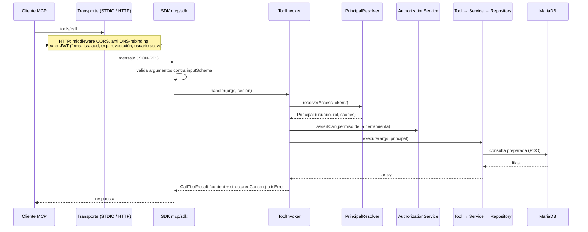

# MCP PHP CRUD Server

Servidor **MCP (Model Context Protocol)** en **PHP 8.3** que permite a agentes de IA (Claude Desktop, OpenCode, Claude Code, Cursor, VS Code…) hacer **CRUD completo** sobre una base de datos **MariaDB/MySQL**, con autenticación por tokens, autorización por roles/scopes y **OAuth 2.1** para el transporte HTTP.

Implementación de referencia: usa el SDK oficial [`mcp/sdk`](https://github.com/modelcontextprotocol/php-sdk) (no hay protocolo propio ni endpoints simulados).

## Tabla de Contenidos

- [Tecnologías utilizadas](#tecnologías-utilizadas)
- [Características](#características)
- [Requisitos](#requisitos)
- [Instalación](#instalación)
- [Scripts para crear la base de datos](#scripts-para-crear-la-base-de-datos)
- [Configuración](#configuración)
- [Cómo ejecutar el proyecto](#cómo-ejecutar-el-proyecto)
- [Ejemplos de uso](#ejemplos-de-uso)
- [Estructura de carpetas completa del proyecto (backend + frontend)](#estructura-de-carpetas-completa-del-proyecto-backend--frontend)
- [Explicaciones breves de cada módulo](#explicaciones-breves-de-cada-módulo)
- [Migración a Otras Bases de Datos en caso de ser necesario](#migración-a-otras-bases-de-datos-en-caso-de-ser-necesario)
- [Solución de Problemas](#solución-de-problemas)
- [Notas Adicionales](#notas-adicionales)

## Tecnologías utilizadas

| Tecnología | Versión / uso |
|---|---|
| **PHP** | ≥ 8.3 (CLI + PHP-FPM/Apache en producción) |
| **mcp/sdk** | ^0.10 — SDK oficial de Model Context Protocol (STDIO, Streamable HTTP, JSON Schema) |
| **league/oauth2-server** | ^9.0 — servidor de autorización OAuth 2.1 embebido |
| **league/oauth2-client** | ^2.7 — cliente para proveedores de identidad externos |
| **nyholm/psr7 + nyholm/psr7-server** | ^1.8 / ^1.1 — mensajes PSR-7 y creación desde la petición global |
| **monolog/monolog** | ^3.5 — logs de aplicación y de seguridad |
| **vlucas/phpdotenv** | ^5.6 — carga de `.env` |
| **symfony/console** | ^7.0 — comandos de administración (`bin/console`) |
| **PDO (`pdo_mysql`)** | Acceso a datos con consultas preparadas reales |
| **PHPUnit** | ^11.0 — pruebas unitarias y de integración |
| **MariaDB / MySQL** | MariaDB 10.6+ o MySQL 8+ (Docker incluye MariaDB 11.4) |
| **Composer** | 2.x — gestión de dependencias y autoload PSR-4 |
| **Docker + Docker Compose** | Entorno reproducible de desarrollo/pruebas (`docker-compose.yml`) |

## Características

- Transportes **STDIO** y **Streamable HTTP** (SDK oficial; negociación de capacidades, `tools/list`, `tools/call`, validación JSON Schema).
- 6 herramientas: `list_records`, `get_record`, `search_records`, `create_record`, `update_record`, `delete_record` (paginación, orden, selección de campos, filtros por texto/fechas/números/estado/NULL).
- **Seguridad**: PDO con consultas preparadas, lista blanca de columnas, validación estricta, borrado en dos pasos (`confirm=true`), errores sin datos internos, eventos de seguridad en BD y log.
- **Autenticación**: tokens personales (solo se guarda su HMAC-SHA256) con expiración y revocación — para STDIO. *No son OAuth.*
- **OAuth 2.1 (HTTP)**: servidor MCP como *resource server* + servidor de autorización embebido (`league/oauth2-server`): authorization code + **PKCE S256 obligatorio**, refresh con rotación, registro dinámico de clientes (RFC 7591), metadatos RFC 8414 y RFC 9728, indicador de recurso (RFC 8707, audiencia del token = `/mcp`), revocación (RFC 7009). La identidad del usuario la aporta un proveedor externo (Google, Microsoft, Keycloak… o `dev` solo en desarrollo) y se **vincula** a la lista de usuarios permitidos.
- **Extensible**: una herramienta nueva = una clase + una línea en `config/tools.php`; otra tabla = otra `EntityDefinition`.
- **Pruebas**: 99 unitarias + 131 de integración (MariaDB real, proceso STDIO real, servidor HTTP real con flujo OAuth completo).

## Requisitos

PHP ≥ 8.3 (`pdo_mysql`, `openssl`, `mbstring`, `curl`), Composer 2, MariaDB 10.6+/MySQL 8+. Alternativa sin instalar nada: Docker (incluido `docker-compose.yml`).

## Instalación

### Con Docker (recomendado)

```bash
docker compose build app && docker compose up -d db
docker compose run --rm app composer install
cp .env.example .env            # edite APP_KEY y OAUTH_ENCRYPTION_KEY:  docker compose run --rm app php bin/console app:generate-key
docker compose run --rm app php bin/console db:install          # tablas + 30 registros + usuarios demo
docker compose run --rm app php bin/console token:create --email=admin@example.com
docker compose run --rm app vendor/bin/phpunit                  # todas las pruebas
```

En `.env` con Docker use `DB_HOST=db`, `DB_USER=mcp_user`, `DB_PASSWORD=mcp_dev_password` y `DB_NAME=mcp_server`. Si su usuario no es UID 1000: `export DOCKER_UID=$(id -u) DOCKER_GID=$(id -g)`. El puerto HTTP se cambia con `HTTP_PORT=...`.

### Instalación nativa (sin Docker)

1. **PHP 8.3+** con extensiones `pdo_mysql openssl mbstring curl`. Ubuntu/Debian: `sudo apt install php8.3-cli php8.3-mysql php8.3-mbstring php8.3-curl php8.3-xml unzip`. macOS: `brew install php`. Windows: php.net + activar extensiones en `php.ini`.
2. **Composer**: https://getcomposer.org/download/ (`composer --version`).
3. **Dependencias**: `composer install --no-dev` (producción) o `composer install` (con PHPUnit).
4. **MariaDB/MySQL**: instale el servidor y cree base y usuario:
   ```sql
   CREATE DATABASE mcp_server CHARACTER SET utf8mb4 COLLATE utf8mb4_unicode_ci;
   CREATE USER 'mcp_user'@'localhost' IDENTIFIED BY 'una-clave-fuerte';
   GRANT SELECT, INSERT, UPDATE, DELETE, CREATE, ALTER, INDEX, DROP, REFERENCES ON mcp_server.* TO 'mcp_user'@'localhost';
   ```
   (Tras instalar, en producción puede reducir a `SELECT, INSERT, UPDATE, DELETE`.)
5. **Configuración**: `cp .env.example .env`; complete `DB_*`, `APP_KEY` y `OAUTH_ENCRYPTION_KEY` (`php bin/console app:generate-key`). `chmod 600 .env`.
6. **Base de datos**: `php bin/console db:install` (ejecuta `database/01..05_*.sql`) — o manualmente `mysql mcp_server < database/01_create_tables.sql` y así sucesivamente. Opciones: `--no-seed` (sin datos), `--fresh` (borra todo antes).
7. **Usuarios y token**: edite `database/04_seed_users.sql` o use `php bin/console user:create persona@empresa.cl --role=admin --name="Persona"`; luego `php bin/console token:create --email=persona@empresa.cl --days=30`.
8. **Ejecutar**: ver [Cómo ejecutar el proyecto](#cómo-ejecutar-el-proyecto).
9. **Verificación**: `php bin/console user:list`; para ver las herramientas: `npx @modelcontextprotocol/inspector php bin/mcp-server`.

Instalación nativa detallada: ver [docs/INSTALLATION.md](docs/INSTALLATION.md).

### Verificar la instalación

```bash
curl -s localhost:8787/health                                  # {"status":"ok"}
curl -s localhost:8787/.well-known/oauth-protected-resource/mcp
vendor/bin/phpunit --testsuite unit
```

## Scripts para crear la base de datos

Los scripts están en `database/` y se ejecutan en orden. `php bin/console db:install` los aplica todos (excepto `00_`, que requiere privilegios administrativos y se ejecuta aparte).

| Script | Contenido |
|---|---|
| `00_create_database.sql` | Crea la base de datos `mcp_server` con `utf8mb4` / `utf8mb4_unicode_ci`. Ejecutar con un usuario administrador. |
| `01_create_tables.sql` | Crea las tablas base: `allowed_users`, `tokens`, `oauth_users`, `oauth_clients`, `oauth_auth_codes`, `oauth_access_tokens`, `oauth_refresh_tokens`, `security_events` y `sample_records`. Incluye `CREATE TABLE IF NOT EXISTS` (idempotente). |
| `02_create_indexes.sql` | Índices únicos y secundarios (correo de usuario, hash de token, identidad OAuth, estado/fechas, búsquedas del CRUD). |
| `03_create_relations.sql` | Claves foráneas entre usuarios, tokens, identidades OAuth, clientes y tokens OAuth, con `ON DELETE CASCADE` donde corresponde. |
| `04_seed_users.sql` | Usuarios demo (`admin@example.com`, `editor@example.com`, `viewer@example.com`, `suspended@example.com`). **Cámbielos por usuarios reales.** |
| `05_seed_sample_data.sql` | 30 registros ficticios en `sample_records` (textos largos, NULLs, decimales, booleanos, fechas y categorías variadas). |

Comandos útiles:

```bash
# Instalación completa (tablas + índices + relaciones + datos demo)
php bin/console db:install

# Solo esquema, sin usuarios ni datos de prueba
php bin/console db:install --no-seed

# Borra TODAS las tablas y reinstala (solo desarrollo/pruebas)
php bin/console db:install --fresh

# Ejecución manual con el cliente mysql
mysql -u root -p < database/00_create_database.sql
mysql -u mcp_user -p mcp_server < database/01_create_tables.sql
mysql -u mcp_user -p mcp_server < database/02_create_indexes.sql
mysql -u mcp_user -p mcp_server < database/03_create_relations.sql
mysql -u mcp_user -p mcp_server < database/04_seed_users.sql
mysql -u mcp_user -p mcp_server < database/05_seed_sample_data.sql
```

> `db:install` **no** ejecuta `00_create_database.sql` (requiere privilegios de administrador y la base debe existir). `--fresh` usa `DROP TABLE`, nunca lo use en producción. Los cambios de esquema futuros deben entregarse como scripts numerados (`06_...`).

## Configuración

Todo se configura con variables de entorno o un archivo `.env` (las variables reales tienen prioridad). Plantilla completa y comentada: [`.env.example`](.env.example). Referencia detallada: [docs/CONFIGURATION.md](docs/CONFIGURATION.md). **No suba `.env` al repositorio** (ya está en `.gitignore`).

### Variables principales

| Variable | Defecto | Descripción |
|---|---|---|
| `APP_ENV` | `production` | `production` exige HTTPS en `APP_URL` y prohíbe `OAUTH_IDP=dev` |
| `APP_KEY` | — (obligatoria) | ≥ 32 caracteres. Clave del HMAC de tokens personales. **Si cambia, todos los tokens personales dejan de ser válidos** |
| `APP_URL` | `http://localhost:8787` | URL pública base. Emisor OAuth = `APP_URL`; recurso MCP = `APP_URL/mcp` |
| `DB_HOST` `DB_PORT` `DB_NAME` `DB_USER` `DB_PASSWORD` | — | Conexión MySQL/MariaDB (usuario con privilegios mínimos) |
| `LOG_PATH` / `LOG_LEVEL` | `storage/logs` / `info` | `app.log` y `security.log`; nivel `debug/info/warning/error` |
| `SESSION_PATH` | `storage/sessions` | Sesiones MCP HTTP y del flujo web OAuth |
| `MCP_ACCESS_TOKEN` | — | Token personal que usa `bin/mcp-server` (STDIO) |
| `TOKEN_MAX_TTL_DAYS` | `90` | Vigencia máxima de un token personal |
| `MCP_HTTP_ALLOW_PERSONAL_TOKENS` | `false` | Acepta tokens `mcp_…` también en HTTP. **No es OAuth**; úselo solo si un cliente no soporta OAuth |
| `MCP_ALLOWED_HOSTS` | `localhost,127.0.0.1,[::1]` | Hosts válidos (anti DNS-rebinding). Se añade automáticamente el host de `APP_URL` |
| `MCP_ALLOWED_ORIGINS` | vacío | Orígenes CORS/Origin permitidos (clientes en navegador) |
| `OAUTH_PRIVATE_KEY` / `OAUTH_PUBLIC_KEY` | `storage/keys/*.pem` | Par RSA (`php bin/console oauth:keys`). La privada: `chmod 600`, fuera del web root |
| `OAUTH_ENCRYPTION_KEY` | — (obligatoria en HTTP) | ≥ 32 caracteres; cifra códigos y refresh tokens |
| `OAUTH_ACCESS_TOKEN_TTL` | `3600` | Segundos |
| `OAUTH_REFRESH_TOKEN_TTL` | `2592000` | 30 días |
| `OAUTH_AUTH_CODE_TTL` | `600` | Segundos |
| `OAUTH_DCR_ENABLED` / `OAUTH_DCR_MAX_PER_HOUR` | `true` / `60` | Registro dinámico de clientes y tope por hora (HTTP 429 al superarlo) |
| `OAUTH_IDP` | `google` | `google`, `microsoft`, `generic`, `dev` (este último solo desarrollo) |
| `OAUTH_IDP_CLIENT_ID` / `_SECRET` | — | Credenciales de **este servidor** como cliente del IdP |
| `OAUTH_IDP_AUTHORIZE_URL` `_TOKEN_URL` `_USERINFO_URL` `_SCOPES` `_NAME` | — | Solo `generic` (Keycloak, Auth0, Okta…) |

### Credenciales y secretos

- `.env` con permisos `600`; en contenedores use secretos/variables del orquestador.
- Los tokens personales y de OAuth **nunca** se guardan en claro (hash HMAC / JWT firmado + `jti`); los secretos de clientes confidenciales, con `password_hash`.
- Los eventos de seguridad redactan automáticamente claves como `token`, `secret`, `password`.

### Transporte MCP

- **STDIO**: `php bin/mcp-server`; stdout es el canal del protocolo (todo log va a archivo/stderr).
- **Streamable HTTP**: `POST /mcp` (JSON-RPC), sesiones con cabecera `Mcp-Session-Id`, autenticación `Authorization: Bearer`.

### Registrar la aplicación en el IdP

URI de redirección autorizada en Google/Microsoft/Keycloak: `{APP_URL}/oauth/callback`. Alcances solicitados: `openid email profile`. El proveedor debe devolver `sub`, `email` y `email_verified` (Google lo hace; para Microsoft el correo se considera verificado).

## Cómo ejecutar el proyecto

### 1. Transporte STDIO (desarrollo local y clientes de escritorio)

```bash
# El token se crea una sola vez y se muestra una única vez
php bin/console token:create --email=admin@example.com --days=30

# Probar el servidor directamente
MCP_ACCESS_TOKEN=mcp_... php bin/mcp-server
```

Normalmente lo lanza el cliente MCP (Claude Desktop, OpenCode, Cursor, VS Code) como subproceso. Configuraciones listas en [`examples/`](examples/); guía por cliente en [docs/AGENTS.md](docs/AGENTS.md).

### 2. Transporte HTTP en desarrollo

```bash
# Claves RSA para firmar los JWT (solo la primera vez o al rotarlas)
php bin/console oauth:keys

# Servidor de desarrollo en http://127.0.0.1:8787
php -S 127.0.0.1:8787 -t public public/index.php
```

Con Docker:

```bash
docker compose --profile http up -d http      # http://localhost:8787
```

### 3. Transporte HTTP en producción

- Apache/Nginx + PHP-FPM con **DocumentRoot en `public/`** y **HTTPS obligatorio**.
- Reescriba todo a `index.php` (Nginx: `try_files $uri /index.php$is_args$args;`).
- Conserve la cabecera `Authorization` (Apache: `SetEnvIf Authorization "(.*)" HTTP_AUTHORIZATION=$1`).
- Use `APP_ENV=production`, `APP_URL=https://mcp.tudominio.example` y un IdP real (`google`, `microsoft` o `generic`). El proveedor `dev` se niega a arrancar en producción.

### 4. Comandos de administración

```bash
php bin/console list                       # todos los comandos
php bin/console user:create ...            # crear usuario permitido
php bin/console user:list                  # listar usuarios
php bin/console user:status suspended --email=...
php bin/console token:create --email=... --days=30
php bin/console token:list
php bin/console token:revoke <id>
php bin/console oauth:keys                 # generar par RSA
php bin/console oauth:client:create "Cliente" --redirect-uri=...
php bin/console oauth:client:revoke <client_id>
php bin/console oauth:revoke-user --email=...
php bin/console maintenance:purge --days=30 --events-days=365
php bin/console app:generate-key           # APP_KEY / OAUTH_ENCRYPTION_KEY
```

### 5. Pruebas

```bash
composer test               # unitarias
composer test:integration   # integración (MariaDB real)
composer test:all           # todas
```

## Ejemplos de uso

Las llamadas siguientes son las que el agente envía como `tools/call`; usted normalmente solo escribe lenguaje natural. Detalle completo de parámetros en [docs/MCP_TOOLS.md](docs/MCP_TOOLS.md).

### Consultas

| Petición al agente | Herramienta |
|---|---|
| "Muéstrame los primeros registros" | `list_records {"per_page":10}` |
| "Página 2, ordenados por precio descendente, solo id, título y precio" | `list_records {"page":2,"sort_by":"price","sort_dir":"desc","fields":["id","title","price"]}` |
| "El registro 5" | `get_record {"id":5}` |
| "Busca 'flota'" | `search_records {"text":"flota"}` |
| "Personas llamadas Camila Rojas" | `search_records {"name":"camila rojas"}` |
| "Activos de tecnología entre 1 y 20 millones" | `search_records {"category":"tecnologia","status":"active","min_price":1000000,"max_price":20000000}` |
| "Eventos del 1 de marzo al 30 de abril de 2025" | `search_records {"date_from":"2025-03-01","date_to":"2025-04-30"}` |
| "Registros sin descripción" | `search_records {"null_fields":["description"]}` |
| "Inactivos" | `search_records {"is_active":false}` |

### Inserciones

"Crea un registro para Ana Soto (ana@example.test), título 'Auditoría', categoría calidad, precio 1500.50":

```json
{"name":"create_record","arguments":{"first_name":"Ana","last_name":"Soto","email":"ana@example.test","title":"Auditoría","category":"calidad","price":1500.5}}
```

→ devuelve el registro con `id` y fechas. Correo duplicado → `conflict`; datos inválidos → `validation_error` con el detalle por campo.

### Actualizaciones

"Pon la cantidad del 31 en 7 y borra sus notas":

```json
{"name":"update_record","arguments":{"id":31,"quantity":7,"notes":null}}
```

Solo cambian los campos enviados; `updated_at` se renueva.

### Eliminaciones

1. "Elimina el registro 31" → `delete_record {"id":31}` → vista previa, **sin borrar**.
2. Tras su aprobación → `delete_record {"id":31,"confirm":true}`.

Requiere rol `admin`; con `editor`/`viewer` responde `forbidden`.

### Permisos por herramienta

| Herramienta | Permiso | Rol mínimo |
|---|---|---|
| `list_records`, `get_record`, `search_records` | `records:read` | viewer |
| `create_record`, `update_record` | `records:write` | editor |
| `delete_record` | `records:delete` | admin |

### Consejos

- Pida campos concretos (`fields`) para ahorrar contexto; el máximo es 100 por página.
- Si el agente dice que no tiene permiso, revise rol y scopes (`user:list`, `token:list`).
- Pruebe interactivamente con el MCP Inspector (`examples/inspector.sh`).

## Estructura de carpetas completa del proyecto (backend + frontend)

> **Sobre el frontend:** este repositorio **no incluye un frontend separado** (no existe `frontend/`, `package.json` ni una SPA). El único punto de entrada web es `public/index.php`, que expone la API MCP y los endpoints OAuth; los clientes MCP (Claude Desktop, OpenCode, Claude Code, Cursor, VS Code, MCP Inspector) actúan como interfaz. Si más adelante se añade una UI, lo natural es servirla desde `public/` (por ejemplo `public/ui/`) o como aplicación independiente que consuma `/mcp`.

```text
mcp_test_php_version/
├── bin/
│   ├── console                     # CLI de administración (Symfony Console)
│   └── mcp-server                  # punto de entrada del transporte STDIO
├── config/
│   └── tools.php                   # registro de las 6 herramientas MCP
├── database/                       # scripts SQL versionados y numerados
│   ├── 00_create_database.sql
│   ├── 01_create_tables.sql
│   ├── 02_create_indexes.sql
│   ├── 03_create_relations.sql
│   ├── 04_seed_users.sql
│   └── 05_seed_sample_data.sql
├── docker/
│   └── Dockerfile                  # imagen PHP 8.3 con pdo_mysql y Composer
├── docs/
│   ├── AGENTS.md                   # integración con Claude Desktop, OpenCode, etc.
│   ├── ARCHITECTURE.md             # arquitectura, componentes y flujos
│   ├── AUTHENTICATION.md           # tokens, roles, OAuth 2.1
│   ├── CONFIGURATION.md            # referencia de variables de entorno
│   ├── INSTALLATION.md             # instalación desde cero
│   ├── MAINTENANCE.md              # respaldos, logs, diagnóstico
│   ├── MCP_TOOLS.md                # herramientas, parámetros y errores
│   ├── TESTING.md                  # estrategia y ejecución de pruebas
│   └── USAGE.md                    # ejemplos de uso con agentes
├── examples/                       # configuración lista para cada cliente
│   ├── claude-code.sh
│   ├── claude_desktop_config.http-bridge.json
│   ├── claude_desktop_config.stdio.json
│   ├── cursor.mcp.json
│   ├── inspector.sh
│   ├── opencode.http-oauth.json
│   ├── opencode.stdio.json
│   └── vscode.mcp.json
├── public/
│   └── index.php                   # entrada HTTP: /mcp, /oauth/*, /.well-known/*, /health
├── src/
│   ├── Authentication/
│   │   ├── HttpPrincipalResolver.php
│   │   ├── PrincipalFactory.php
│   │   ├── PrincipalResolverInterface.php
│   │   └── StdioPrincipalResolver.php
│   ├── Authorization/
│   │   ├── AuthorizationService.php
│   │   ├── Permission.php
│   │   ├── Principal.php
│   │   └── Role.php
│   ├── Console/
│   │   ├── BaseCommand.php
│   │   ├── ConsoleFactory.php
│   │   ├── DbInstallCommand.php
│   │   ├── GenerateKeyCommand.php
│   │   ├── OAuthClientCreateCommand.php
│   │   ├── OAuthClientRevokeCommand.php
│   │   ├── OAuthKeysCommand.php
│   │   ├── OAuthRevokeUserCommand.php
│   │   ├── PurgeCommand.php
│   │   ├── TokenCreateCommand.php
│   │   ├── TokenListCommand.php
│   │   ├── TokenRevokeCommand.php
│   │   ├── UserCreateCommand.php
│   │   ├── UserListCommand.php
│   │   └── UserStatusCommand.php
│   ├── Core/
│   │   ├── Application.php         # raíz de composición (servicios perezosos)
│   │   ├── Config.php              # .env + variables de entorno
│   │   └── SystemClock.php
│   ├── Database/
│   │   ├── Connection.php          # PDO perezoso, transacciones, errores saneados
│   │   └── SchemaInstaller.php     # ejecuta database/*.sql en orden
│   ├── Domain/
│   │   ├── Column.php
│   │   ├── ColumnType.php
│   │   ├── EntityDefinition.php    # metadatos de tabla y lista blanca de columnas
│   │   ├── Filter.php
│   │   ├── Page.php
│   │   └── RecordCriteria.php
│   ├── Exceptions/
│   │   ├── AuthenticationException.php
│   │   ├── AuthorizationException.php
│   │   ├── ConfigurationException.php
│   │   ├── ConflictException.php
│   │   ├── DatabaseException.php
│   │   ├── McpPhpException.php
│   │   ├── NotFoundException.php
│   │   └── ValidationException.php
│   ├── Http/
│   │   ├── CompositeTokenValidator.php
│   │   ├── Kernel.php              # rutas HTTP y middleware
│   │   └── ResponseEmitter.php
│   ├── Logging/
│   │   └── SecurityLogger.php      # log + tabla security_events, redacta secretos
│   ├── Mcp/
│   │   ├── ServerFactory.php
│   │   ├── ToolAwareReferenceHandler.php
│   │   ├── ToolInterface.php
│   │   ├── ToolInvoker.php         # identidad → permiso → ejecución → errores
│   │   └── ToolRegistry.php
│   ├── OAuth/
│   │   ├── AccessTokenValidator.php
│   │   ├── AuthorizationServerFactory.php
│   │   ├── OAuthConfig.php
│   │   ├── Endpoints/
│   │   │   ├── AuthorizationEndpoint.php
│   │   │   ├── ClientRegistrationEndpoint.php
│   │   │   ├── MetadataEndpoint.php
│   │   │   ├── Responses.php
│   │   │   ├── TokenEndpoint.php
│   │   │   └── WebSession.php
│   │   ├── Entities/
│   │   │   ├── AccessTokenEntity.php
│   │   │   ├── AuthCodeEntity.php
│   │   │   ├── ClientEntity.php
│   │   │   ├── RefreshTokenEntity.php
│   │   │   ├── ScopeEntity.php
│   │   │   └── UserEntity.php
│   │   ├── Identity/
│   │   │   ├── DevIdentityProvider.php
│   │   │   ├── ExternalIdentity.php
│   │   │   ├── GenericOAuthProvider.php
│   │   │   ├── IdentityLinkService.php
│   │   │   └── IdentityProviderInterface.php
│   │   └── Repositories/
│   │       ├── AccessTokenRepository.php
│   │       ├── AuthCodeRepository.php
│   │       ├── ClientRepository.php
│   │       ├── RefreshTokenRepository.php
│   │       └── ScopeRepository.php
│   ├── Repositories/
│   │   ├── PdoRecordRepository.php # CRUD genérico con PDO
│   │   ├── RecordRepositoryInterface.php
│   │   ├── TokenRepository.php
│   │   └── UserRepository.php
│   ├── Services/
│   │   └── RecordService.php       # lógica de negocio, borrado en dos pasos, auditoría
│   ├── Tokens/
│   │   ├── TokenGenerator.php
│   │   └── TokenService.php        # emisión, hash, validación, expiración, revocación
│   ├── Tools/
│   │   ├── AbstractRecordTool.php
│   │   ├── CreateRecordTool.php
│   │   ├── DeleteRecordTool.php
│   │   ├── GetRecordTool.php
│   │   ├── ListRecordsTool.php
│   │   ├── SearchRecordsTool.php
│   │   └── UpdateRecordTool.php
│   └── Validators/
│       ├── CriteriaFactory.php     # validación/normalización de consultas
│       └── RecordValidator.php     # validación de escritura por columna
├── storage/
│   ├── keys/.gitkeep               # claves RSA (no versionadas)
│   ├── logs/.gitkeep               # app.log y security.log
│   └── sessions/.gitkeep           # sesiones HTTP/OAuth
├── tests/
│   ├── bootstrap.php
│   ├── Integration/
│   │   ├── HttpOAuthTest.php
│   │   ├── IdentityLinkIntegrationTest.php
│   │   ├── McpStdioServerTest.php
│   │   ├── RecordCrudTest.php
│   │   ├── SchemaTest.php
│   │   ├── TokenAuthIntegrationTest.php
│   │   └── ToolsIntegrationTest.php
│   ├── Support/
│   │   ├── DatabaseTestCase.php
│   │   ├── FrozenClock.php
│   │   ├── HttpServerProcess.php
│   │   ├── InMemoryRepositories.php
│   │   ├── McpStdioProcess.php
│   │   └── TestHttpClient.php
│   └── Unit/
│       ├── AccessTokenValidatorTest.php
│       ├── AuthorizationTest.php
│       ├── CriteriaFactoryTest.php
│       ├── MiscUnitTest.php
│       ├── RecordValidatorTest.php
│       ├── TokenServiceTest.php
│       ├── ToolInvokerTest.php
│       └── ToolRegistryTest.php
├── .env.example                    # plantilla de configuración comentada
├── .gitignore
├── composer.json
├── composer.lock
├── docker-compose.yml              # MariaDB 11.4 + app PHP + perfil HTTP
├── phpunit.xml.dist                # suites unit e integration
├── LICENSE                         # Apache-2.0
└── README.md
```

## Explicaciones breves de cada módulo

| Directorio / archivo | Responsabilidad |
|---|---|
| `Core` | `Application` (raíz de composición, singletons perezosos), `Config` (.env/entorno), reloj |
| `Mcp` | `ServerFactory` (construye el servidor), `ToolInterface`, `ToolRegistry`, `ToolInvoker` (identidad → permiso → ejecución → traducción de errores), `ToolAwareReferenceHandler` |
| `Tools` | Las 6 herramientas (finas: no validan nada, delegan en el servicio) |
| `Services` | `RecordService`: lógica de negocio del CRUD, borrado en dos pasos, auditoría |
| `Validators` | `RecordValidator` (escritura), `CriteriaFactory` (consultas) |
| `Domain` | `EntityDefinition`/`Column` (metadatos de tabla), criterios, página |
| `Repositories` | `PdoRecordRepository` (genérico), `UserRepository`, `TokenRepository` |
| `Database` | `Connection` (PDO perezoso, errores saneados), `SchemaInstaller` |
| `Authentication` | `PrincipalResolver`: STDIO (token en entorno, revalidado en cada llamada) / HTTP (AccessToken ya validado) |
| `Authorization` | `Role`, `Permission`, `Principal`, `AuthorizationService` |
| `Tokens` | Generación, hash, emisión, validación, expiración y revocación de tokens personales |
| `OAuth` | Servidor de autorización (league), entidades/repositorios, validador JWT, endpoints, proveedores de identidad externos |
| `Http` | `Kernel` (rutas), emisor PSR-7, validador compuesto |
| `Logging` | `SecurityLogger` (log + tabla `security_events`, redacta secretos) |
| `Exceptions` | Jerarquía `McpPhpException`: mensaje seguro para el cliente, detalle técnico solo en `previous` → log |
| `Console` | Comandos de administración (`bin/console`) |
| `config/tools.php` | Registro de herramientas: agregar una entrada basta para exponerla |
| `database/` | Esquema, índices, relaciones y datos demo versionados |
| `public/index.php` | Front controller HTTP (`/mcp`, `/oauth/*`, `/.well-known/*`, `/health`) |
| `bin/mcp-server` | Entrada STDIO (stdout = protocolo; logs a archivo/stderr) |
| `bin/console` | Entrada de la CLI de administración |
| `tests/` | `Unit` (sin BD), `Integration` (MariaDB, STDIO y HTTP reales), `Support` (utilidades) |
| `storage/` | Claves RSA, logs y sesiones (fuera del control de versiones) |
| `examples/` | Configuraciones de clientes MCP listas para copiar |

### Flujo de una llamada



### Modelo de datos

`allowed_users` 1—N `tokens` · 1—N `oauth_users` · 1—N `oauth_access_tokens`/`oauth_auth_codes` (FK a `oauth_clients`) · `oauth_refresh_tokens` → `oauth_access_tokens` · `security_events` · `sample_records` (datos de prueba). Scripts en `database/`.

### Extensibilidad

- **Nueva herramienta**: implementar `ToolInterface` y añadirla a `config/tools.php`. El núcleo no cambia.
- **Nueva tabla**: crear una `EntityDefinition`; `PdoRecordRepository`, `RecordValidator`, `CriteriaFactory` y `RecordService` son genéricos.
- **Otro método de autenticación**: implementar `PrincipalResolverInterface` y/o `AuthorizationTokenValidatorInterface`.
- **Otro IdP**: `OAUTH_IDP=generic` o implementar `IdentityProviderInterface`.
- **Servidor de autorización externo** (Keycloak, Auth0…): reemplazar `AccessTokenValidator` por `Mcp\Server\Transport\Http\OAuth\JwtTokenValidator` del SDK (JWKS/OIDC) y apuntar `authorization_servers` al emisor externo.

## Migración a Otras Bases de Datos en caso de ser necesario

**Estado actual:** el proyecto está diseñado y probado **solo para MySQL/MariaDB**. No hay una capa de abstracción de dialecto SQL; si necesita PostgreSQL, SQLite, SQL Server u Oracle, estos son los puntos que debe adaptar.

### Puntos de acoplamiento con MySQL/MariaDB

| Ubicación | Dependencia |
|---|---|
| `src/Database/Connection.php` | DSN `mysql:host=...;dbname=...;charset=utf8mb4` (método `mysql()`), `SET time_zone = '+00:00'`, chequeo de `pdo_mysql` |
| `src/Repositories/PdoRecordRepository.php` | Identificadores entre backticks (`` `columna` ``), `LIMIT %d OFFSET %d`, `CONCAT(...)`, `LIKE ... ESCAPE '\\'`, `CURRENT_TIMESTAMP`, detección de duplicado por `errorInfo[1] === 1062` |
| `src/Database/SchemaInstaller.php` | `SHOW TABLES`, `SET FOREIGN_KEY_CHECKS = 0/1`, backticks en `DROP TABLE`, separación de sentencias por `;` |
| `database/*.sql` | `AUTO_INCREMENT`, `ENUM(...)`, `TINYINT(1)`, `ON UPDATE CURRENT_TIMESTAMP`, `ENGINE=InnoDB`, `utf8mb4`, backticks, `UNSIGNED` |
| `tests/Support/DatabaseTestCase.php` | Asume un servidor MariaDB/MySQL y crea la base de pruebas con credenciales de administrador |
| `db:install --fresh` | Usa `DROP TABLE` + `FOREIGN_KEY_CHECKS`, exclusivo de MySQL/MariaDB |

### Pasos sugeridos de migración

1. **Driver y DSN.** Añada una fábrica por motor en `Connection` (por ejemplo `Connection::pgsql()`, `Connection::sqlite()`) o un `Connection::fromDsn()` que reciba el DSN completo. Mantenga `ATTR_EMULATE_PREPARES = false` donde exista.
2. **Dialecto de identificadores.** Sustituya el entrecomillado fijo por uno según el driver:
   - MySQL/MariaDB: `` `columna` ``
   - PostgreSQL / SQLite / Oracle: `"columna"`
   - SQL Server: `[columna]`
   La forma más limpia es extraer un `SqlDialect`/`IdentifierQuoter` inyectado en `PdoRecordRepository` y `SchemaInstaller`.
3. **Portar el esquema.** Mantenga los scripts numerados y cree una variante por motor (`database/postgresql/01_create_tables.sql`, etc.). Equivalencias habituales:

   | MySQL/MariaDB | PostgreSQL | SQLite | SQL Server |
   |---|---|---|---|
   | `INT UNSIGNED AUTO_INCREMENT` | `SERIAL` o `GENERATED ALWAYS AS IDENTITY` | `INTEGER PRIMARY KEY AUTOINCREMENT` | `INT IDENTITY(1,1)` |
   | `ENUM('a','b')` | `VARCHAR` + `CHECK (col IN (...))` (o tipo `ENUM` nativo) | `TEXT` + `CHECK` | `VARCHAR` + `CHECK` |
   | `TINYINT(1)` (booleano) | `BOOLEAN` | `INTEGER` (0/1) | `BIT` |
   | `DATETIME` / `TIMESTAMP` | `TIMESTAMP` / `TIMESTAMPTZ` | `TEXT` ISO-8601 o `DATETIME` | `DATETIME2` |
   | `TEXT`, `VARCHAR(n)` | `TEXT`, `VARCHAR(n)` | `TEXT` | `NVARCHAR(n)`, `NVARCHAR(MAX)` |
   | `DECIMAL(12,2)` | `NUMERIC(12,2)` | `NUMERIC` | `DECIMAL(12,2)` |
   | `ON UPDATE CURRENT_TIMESTAMP` | trigger `BEFORE UPDATE` | trigger `AFTER UPDATE` | trigger `AFTER UPDATE` |
   | `ENGINE=InnoDB DEFAULT CHARSET=utf8mb4` | no aplica | no aplica | no aplica |
   | `UNSIGNED`, backticks | eliminar / `"` | eliminar / `"` | eliminar / `[]` |

4. **Consultas del repositorio.**
   - **Paginación:** `LIMIT ... OFFSET ...` funciona en PostgreSQL y SQLite; en SQL Server use `OFFSET ... ROWS FETCH NEXT ... ROWS ONLY` (requiere `ORDER BY`, que ya se genera).
   - **Concatenación:** `CONCAT(a, ' ', b)` existe en PostgreSQL/MySQL; en SQLite use `a || ' ' || b`.
   - **Mayúsculas/minúsculas:** MySQL usa una colación `_ci`; en PostgreSQL/SQLite el `LIKE` distingue mayúsculas. Use `ILIKE` (PostgreSQL) o `LOWER(col) LIKE LOWER(:term)`.
   - **Comodines:** revise `ESCAPE '\\'`; en PostgreSQL el literal correcto suele ser `ESCAPE '\'`.
   - **Booleanos:** PostgreSQL acepta `true/false`; SQLite y SQL Server necesitan `1/0`. `bindable()` ya convierte a entero, ajústelo si su motor exige otro tipo.
   - **`lastInsertId()`:** en PostgreSQL requiere `RETURNING id` o el nombre de la secuencia (`$pdo->lastInsertId('tabla_id_seq')`). En SQL Server use `SCOPE_IDENTITY()`/`OUTPUT INSERTED.id`.
   - **Duplicados:** reemplace el código `1062` por el de su motor: PostgreSQL `23505`, SQLite `19`/`2067`, SQL Server `2627`/`2601`.
5. **Adaptar `SchemaInstaller`.**
   - `SHOW TABLES` → `information_schema.tables` (PostgreSQL/SQL Server) o `sqlite_master` (SQLite).
   - `SET FOREIGN_KEY_CHECKS` → `SET session_replication_role = replica` (PostgreSQL, requiere privilegios) o desactivar checks al crear/dropear en SQLite.
   - `DROP TABLE` con backticks → entrecomillado del dialecto y, si hay FKs, `DROP ... CASCADE`.
   - El separador por `;` es suficiente para estos scripts, pero si adopta funciones/triggers con `$$` o `BEGIN...END`, use un splitter específico por motor.
6. **Ajustar la autenticación.** Las tablas `allowed_users`, `tokens`, `oauth_*` y `security_events` son portables tras cambiar tipos (`ENUM` → `VARCHAR + CHECK`, `TINYINT(1)` → `BOOLEAN`). Revise índices únicos y `ON DELETE CASCADE` en el nuevo motor.
7. **Pruebas.** Configure `TEST_DB_*` para el nuevo motor, duplique la suite de integración y valide: CRUD completo, filtros, paginación, concurrencia de tokens, flujo OAuth (authorization code + PKCE + refresh) y `db:install`. Sin pruebas de integración reales no considere la migración terminada.
8. **Documente y versione.** Añada el nuevo motor a `.env.example`/docs, mantenga las variantes SQL en carpetas separadas y actualice los requisitos y el Dockerfile (extensión PDO correspondiente: `pdo_pgsql`, `pdo_sqlite`, `pdo_sqlsrv`).

> **Alternativa recomendada:** si el objetivo es usar otro motor, la vía de menor riesgo es mantener MySQL/MariaDB o usar un servicio compatible (por ejemplo, un MySQL gestionado). Migrar el dialecto implica tocar repositorio, instalador, esquema y pruebas a la vez.

## Solución de Problemas

| Síntoma | Causa / solución |
|---|---|
| Cliente: "server disconnected" (STDIO) | Ejecute `php bin/mcp-server` a mano: falta `MCP_ACCESS_TOKEN`, token vencido/revocado, `APP_KEY` distinta a la que emitió el token, `php` fuera del PATH del cliente |
| `database_error` en herramientas | Revise `app.log` (el cliente no ve el detalle): credenciales, BD caída, `pdo_mysql` no instalado |
| HTTP 401 persistente | `WWW-Authenticate`/`security.log` (`oauth.access_token_rejected`, motivo `invalid_signature_audience_or_expired` o `revoked`); compruebe que `APP_URL` coincide exactamente con la URL usada por el cliente y que el reloj del servidor es correcto |
| HTTP 403 en `/mcp` | Anti DNS-rebinding: añada el host a `MCP_ALLOWED_HOSTS` (y el origen a `MCP_ALLOWED_ORIGINS`) |
| Bearer no llega tras Apache/Nginx | Reenvíe `Authorization` (ver INSTALLATION.md) |
| "Acceso denegado" al iniciar sesión | El correo del IdP no está en `allowed_users` (activo) o no está verificado: `oauth.login_denied` |
| `forbidden` en una herramienta | Rol/scopes insuficientes (`delete_record` = admin) |
| `invalid_grant` al refrescar | Refresh ya usado (rotación), revocado o expirado: reconectar |
| `Falta la clave publica OAuth` | `php bin/console oauth:keys` |
| Puerto 8787 ocupado | `HTTP_PORT=9000 docker compose --profile http up -d http` y actualice `APP_URL` |

### Diagnóstico rápido

```bash
# ¿Responde el servidor HTTP?
curl -s localhost:8787/health

# ¿Qué usuarios y tokens existen?
php bin/console user:list
php bin/console token:list

# ¿Qué errores registró el servidor?
tail -n 50 storage/logs/app.log
tail -n 50 storage/logs/security.log

# Eventos de seguridad recientes (BD)
mysql -u mcp_user -p mcp_server -e \
  "SELECT created_at,event_type,user_id,details FROM security_events WHERE severity<>'info' ORDER BY id DESC LIMIT 50;"

# ¿Las pruebas unitarias siguen pasando?
vendor/bin/phpunit --testsuite unit
```

### Logs y limpieza

- `storage/logs/app.log` (errores internos con traza), `storage/logs/security.log` y tabla `security_events` (auditoría). Rotación con logrotate:
  ```
  /ruta/storage/logs/*.log { weekly rotate 8 compress missingok notifempty create 0640 www-data www-data }
  ```
- Limpieza periódica (cron): `0 3 * * * cd /ruta && php bin/console maintenance:purge --days=30 --events-days=365`
- Alertas recomendadas: ráfagas de `token.rejected`, `oauth.login_denied`, `authorization.denied`, `record.deleted`.
- Claude Desktop guarda el stderr del servidor STDIO en su carpeta de logs (ver docs/AGENTS.md).

### Operaciones frecuentes

| Tarea | Comando |
|---|---|
| Rotar un token personal | `token:create …` → actualizar el cliente → `token:revoke <id>` |
| Bloquear a alguien ya | `user:status suspended --email=…` (invalida todo al instante) |
| Quitar un cliente OAuth | `oauth:client:revoke <client_id>` |
| Rotar claves RSA | `oauth:keys --force` (los usuarios deberán reconectar) |
| Cambiar rol | `UPDATE allowed_users SET role='editor' WHERE email='…'` (los scopes se recortan al refrescar) |

## Notas Adicionales

### Documentación detallada

| Documento | Contenido |
|---|---|
| [docs/ARCHITECTURE.md](docs/ARCHITECTURE.md) | Arquitectura, componentes, flujos, diagramas |
| [docs/INSTALLATION.md](docs/INSTALLATION.md) | Instalación desde cero |
| [docs/CONFIGURATION.md](docs/CONFIGURATION.md) | Variables de entorno |
| [docs/MCP_TOOLS.md](docs/MCP_TOOLS.md) | Herramientas, parámetros, respuestas, errores |
| [docs/AGENTS.md](docs/AGENTS.md) | Claude Desktop, OpenCode y otros clientes (STDIO/HTTP) |
| [docs/AUTHENTICATION.md](docs/AUTHENTICATION.md) | Tokens, roles, OAuth 2.1, seguridad |
| [docs/USAGE.md](docs/USAGE.md) | Ejemplos de uso con agentes |
| [docs/TESTING.md](docs/TESTING.md) | Pruebas |
| [docs/MAINTENANCE.md](docs/MAINTENANCE.md) | Respaldos, logs, diagnóstico |

Configuraciones listas para adaptar: [`examples/`](examples/).

### Estado y límites

- El SDK `mcp/sdk` es 0.x: fije la versión en `composer.lock` y pruebe antes de actualizar.
- Verificado contra el protocolo con clientes JSON-RPC/HTTP propios; la conexión con aplicaciones concretas (Claude Desktop, OpenCode…) sigue sus documentaciones oficiales, ver [docs/AGENTS.md](docs/AGENTS.md).
- El proveedor `dev` es solo para desarrollo y se niega a arrancar con `APP_ENV=production`.
- En producción **HTTPS es obligatorio** para HTTP/OAuth.
- Solo MySQL/MariaDB de fábrica; para otros motores consulte la sección de migración.

### Respaldos

```bash
mysqldump --single-transaction --routines mcp_server | gzip > backup_$(date +%F).sql.gz   # restaurar: gunzip -c … | mysql mcp_server
```

Respalde además `.env` y `storage/keys/` (en un lugar cifrado): **perder las claves RSA invalida todos los access tokens; perder `APP_KEY` invalida los tokens personales; perder `OAUTH_ENCRYPTION_KEY` invalida refresh tokens y códigos**.

### Actualizaciones

```bash
git pull && composer install --no-dev --optimize-autoloader
php bin/console db:install --no-seed   # NO usar --fresh en producción; los scripts usan CREATE TABLE IF NOT EXISTS
vendor/bin/phpunit --testsuite unit
```

Los cambios de esquema futuros deben entregarse como scripts `ALTER` numerados en `database/` (`06_…`). `mcp/sdk` es 0.x: lea su CHANGELOG antes de subir de versión y ejecute las suites completas.

### Licencia

Licencia: Apache-2.0 (ver `LICENSE`).
