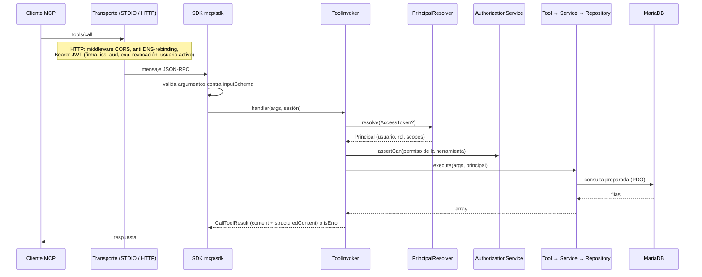
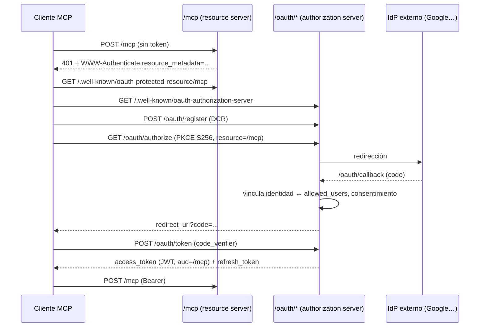

# Arquitectura

## Biblioteca MCP

Se evaluó el SDK oficial **`mcp/sdk`** (modelcontextprotocol/php-sdk, mantenido con Symfony/PHP Foundation, v0.10). Cubre STDIO, Streamable HTTP, sesiones, validación de esquemas y middleware de autorización OAuth (servidor de recursos). Se eligió por ser oficial, mantenido y compatible con las revisiones de protocolo 2024-11-05 → 2026-07-28.

## Componentes (`src/`)

| Directorio | Responsabilidad |
|---|---|
| `Core` | `Application` (raíz de composición, singletons perezosos), `Config` (.env/entorno), reloj |
| `Mcp` | `ServerFactory` (construye el servidor), `ToolInterface`, `ToolRegistry`, `ToolInvoker` (identidad → permiso → ejecución → traducción de errores), `ToolAwareReferenceHandler` |
| `Tools` | Las 6 herramientas (finas: validan nada, delegan en el servicio) |
| `Services` | `RecordService`: lógica de negocio del CRUD, borrado en dos pasos, auditoría |
| `Validators` | `RecordValidator` (escritura), `CriteriaFactory` (consultas) |
| `Domain` | `EntityDefinition`/`Column` (metadatos de tabla), criterios, página |
| `Repositories` | `PdoRecordRepository` (genérico), `UserRepository`, `TokenRepository` |
| `Database` | `Connection` (PDO perezoso, errores saneados), `SchemaInstaller` |
| `Authentication` | `PrincipalResolver`: STDIO (token en entorno, revalidado en cada llamada) / HTTP (AccessToken ya validado) |
| `Authorization` | `Role`, `Permission`, `Principal`, `AuthorizationService` |
| `Tokens` | Generación, hash, emisión, validación, expiración y revocación de tokens personales |
| `OAuth` | Servidor de autorización (league), entidades/repositorios, validador JWT, endpoints, proveedores de identidad externos |
| `Http` | `Kernel` (rutas), emisor PSR-7, validador compuesto |
| `Logging` | `SecurityLogger` (log + tabla `security_events`, redacta secretos) |
| `Exceptions` | Jerarquía `McpPhpException`: mensaje seguro para el cliente, detalle técnico solo en `previous` → log |
| `Console` | Comandos de administración (`bin/console`) |

## Flujo de una llamada

## Autorización OAuth (HTTP)

## Modelo de datos

`allowed_users` 1—N `tokens` · 1—N `oauth_users` · 1—N `oauth_access_tokens`/`oauth_auth_codes` (FK a `oauth_clients`) · `oauth_refresh_tokens` → `oauth_access_tokens` · `security_events` · `sample_records` (datos de prueba). Scripts en `database/`.

## Extensibilidad

- **Nueva herramienta**: implementar `ToolInterface` y añadirla a `config/tools.php`. El núcleo no cambia.
- **Nueva tabla**: crear una `EntityDefinition`; `PdoRecordRepository`, `RecordValidator`, `CriteriaFactory` y `RecordService` son genéricos.
- **Otro método de autenticación**: implementar `PrincipalResolverInterface` y/o `AuthorizationTokenValidatorInterface`.
- **Otro IdP**: `OAUTH_IDP=generic` o implementar `IdentityProviderInterface`.
- **Servidor de autorización externo** (Keycloak, Auth0…): reemplazar `AccessTokenValidator` por `Mcp\Server\Transport\Http\OAuth\JwtTokenValidator` del SDK (JWKS/OIDC) y apuntar `authorization_servers` al emisor externo.
